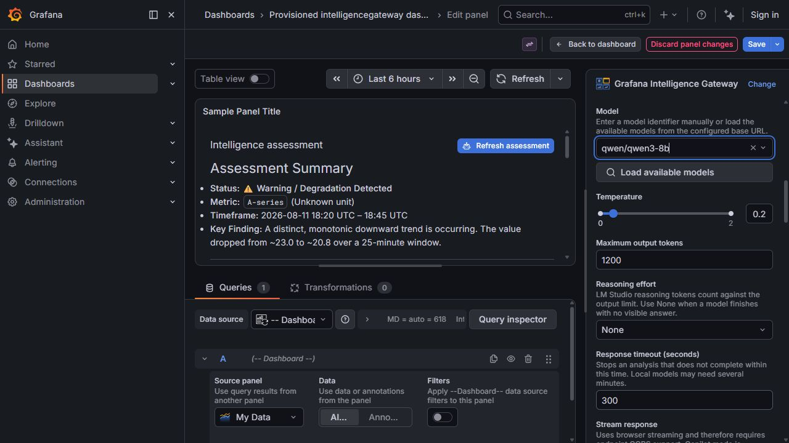

# Grafana Intelligence Gateway

Grafana Intelligence Gateway is DigitalRCS's AI assessment panel for Grafana. It turns selected query results, dashboard captures, or uploaded images into an assessment from an administrator-approved local or hosted model, rendered as theme-aware Markdown.

Version **1.1.2** requires companion **`digitalrcs-intelligencegateway-datasource` 1.1.0 or later**. The companion stores credentials in Grafana `secureJsonData` and enforces provider, model, token, timeout, payload, and rate policies server-side. The panel has no credential or direct provider-URL fields.

## Choose the evidence

| Assessment      | Setup                                                                                                                        | Action                                  |
| --------------- | ---------------------------------------------------------------------------------------------------------------------------- | --------------------------------------- |
| Data only       | Connect queries, commonly **Queries → Dashboard → Source panel**; leave images unattached.                                   | **Analyze**                             |
| Images only     | Select the secure AI instance, turn **Include query data with images** off, and prepare previews. No query results required. | **Use images**, then **Analyze images** |
| Data and images | Connect query data and leave **Include query data with images** on; prepare previews.                                        | **Use images**, then **Analyze images** |

**Secure AI data source** is the model connection, not the **Queries** data source. Capturing a panel adds pixels, not its underlying query results. The Current View Exporter plugin is not required. Images are never submitted automatically; **Clear analysis** cancels a request and removes the answer, errors, and pending images without changing measurements.

Start with [Panel Setup and Configuration](Panel-Setup-and-Configuration), then [Image Analysis](Image-Analysis). The six provider choices are OpenAI, LM Studio, Open WebUI, the optional Grafana LLM app, custom OpenAI-compatible Chat Completions, and Copilot Studio Direct Line **preview**. Copilot is not an enterprise SSO integration; see its [authentication boundaries](Copilot-Studio-Notes).

Trying the supplied demo? **DEMO ONLY - Mock AI (no inference)** returns a fixed receipt, not an assessment. Follow the [two-phase walkthrough](Reviewer-Walkthrough): first verify the mock path, then create and select a **separate real-provider instance**. Check the analysis panel's current **AI connection label**; the dashboard introduction describes only the supplied default. TestData and **Queries → Dashboard** provide evidence, not an AI model.

## Pages

- [Reviewer Walkthrough](Reviewer-Walkthrough): purpose, mock versus real inference, and a worked traffic assessment
- [Installation](Installation)
- [Release notes: 1.1.0](https://github.com/digitalrcs/grafana-intelligence-gateway/blob/main/docs/RELEASE_NOTES_1.1.0.md)
- [Panel Setup and Configuration](Panel-Setup-and-Configuration)
- [AI Provider Configuration](Configuration-AI-Providers)
- [Connecting Data from Other Panels](Connecting-Data-from-Other-Panels)
- [Image Analysis](Image-Analysis)
- [Copilot Studio Notes](Copilot-Studio-Notes)
- [Prompt Engineering Guide](Prompt-Engineering-Guide)
- [LM Studio Setup](LM-Studio-Setup)
- [OpenAI Setup](OpenAI-Setup)
- [Development and Contributing](Development-and-Contributing)
- [Security Considerations](Security-Considerations)
- [Secure Backend and Secret Storage](Secure-Backend-and-Secrets)
- [Grafana Compatibility and Certification](Grafana-Compatibility-and-Certification)
- [Roadmap](Roadmap)
