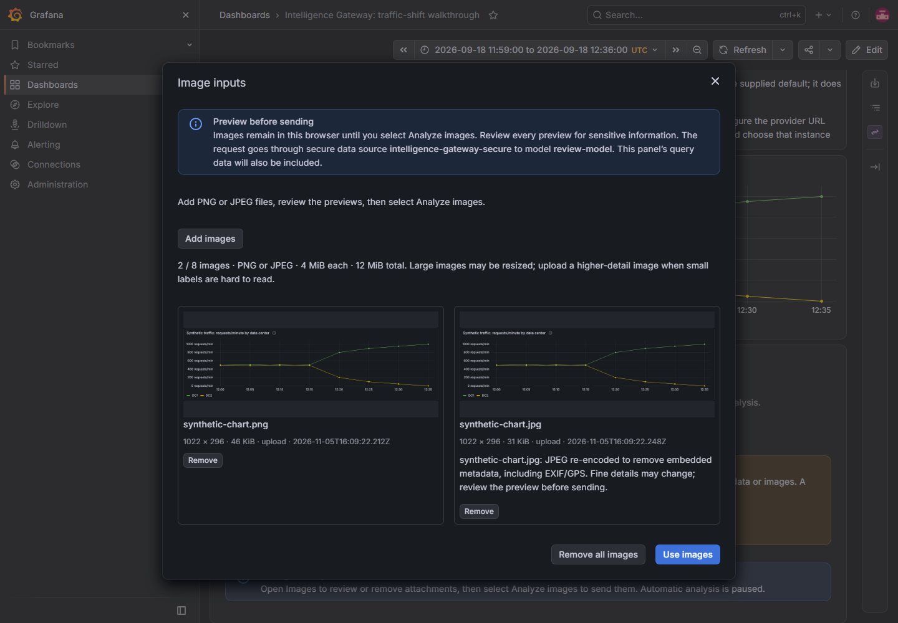

> Public 1.2.1 documentation; see [Public Edition](Public-Edition) for scope and release status.

# Image Analysis

Use uploaded PNG/JPEG images as evidence for an Intelligence Gateway assessment. Public panel **1.2.1** requires secure companion **1.1.0 or later**; install the companion first and restart Grafana. Version 1.0.1 does not include image support. The Current View Exporter plugin does not need to be installed.

## Choose the evidence

| Mode            | Query setup                                                 | Image setup and action                                                                                       |
| --------------- | ----------------------------------------------------------- | ------------------------------------------------------------------------------------------------------------ |
| Data only       | Use this panel's queries or **Dashboard → Source panel**. | Leave images unattached; select **Analyze**.                                                                 |
| Images only     | No query results or Dashboard source required.              | Turn **Include query data with images** off; preview images, select **Use images**, then **Analyze images**. |
| Data and images | Connect the query results needed for precise values.        | Leave **Include query data with images** on; preview images, select **Use images**, then **Analyze images**. |

Every mode requires **1. Connect AI → Secure AI data source**. This setting selects the model connection and is separate from **Queries → Dashboard**, which shares measurements. Attaching images permits an images-only assessment even when **When no data arrives** is set to **Block**.

## Upload, preview, and send

1. Prepare approved PNG/JPEG files. For combined analysis, also select the query time range.
2. Select **Images** to open **Image inputs**.
3. Choose **Add images** and select PNG/JPEG files.
4. Review every preview, remove unwanted images, and check warnings and label legibility.
5. Select **Use images**. This closes the preview without sending anything.
6. Select **Analyze images** to submit the prepared images and prompt through the configured secure AI data source.

**Remove** discards one attachment; **Remove all images** discards all staged images. **Clear analysis** cancels an active request and removes the assessment, errors, and pending images, leaving measurements unchanged. Successful image assessments release their attachments; attach again for another image assessment.

Auto-analysis never sends images and pauses while attachments or the image dialog are active. Images remain in browser memory, not dashboard JSON or persistent browser storage. Clearing cannot retract content already sent to a provider.

## Public-edition boundaries

This edition has no dashboard capture, panel discovery, or selected-panel capture. Upload a locally saved PNG/JPEG screenshot when visual context is needed. PDF, CSV, and office-document uploads are not supported. Upload processing uses a detached canvas and does not inspect dashboard DOM or call a rendering server.

Use **Queries → Dashboard → Source panel** to share an existing panel's query results without duplicating its query. Upload processing does not fetch source data; Grafana still controls initial loads and scheduled refreshes. Images provide pixels, not DataFrames, and models can misread small text and axes.

## Provider and safety requirements

- Turn on **Enable image analysis** (`enableVision`, off by default) in the companion. Add the approved vision-capable model to both the normal model allow-list and **Allowed vision models** (`allowedVisionModels`). An enabled configuration with an empty vision list is rejected. Discovery and allow-list membership do not make a text-only model vision-capable.
- OpenAI, LM Studio, Open WebUI, custom OpenAI-compatible Chat Completions, and the optional Grafana LLM app support structured image requests through their adapters. Actual model and parameter compatibility must be checked. Use the [provider guide](Configuration-AI-Providers) and perform an approved real-provider test with known visual facts.
- The Grafana LLM option uses a dedicated Grafana service-account token in `secureJsonData.bearerToken`, not the user's SSO session. Its `base`/`large` aliases are configured in `grafana-llm-app`. App 1.2.0 requires Grafana 13 and has a two-minute upstream timeout.
- Copilot Studio has a **Direct Line preview adapter** with server-side `secureJsonData.directLineSecret`, isolated conversations, bounded reply polling, and multipart image uploads. It is not corporate SSO, delegated Entra authentication, or app-only Direct-to-Engine access. See [Copilot Studio Notes](Copilot-Studio-Notes) for completion-contract and tenant prerequisites. Never disable agent authentication to make it work; Contract tests are not live tenant validation.
- Limits: 8 images; 4 MiB decoded file size per image; 12 MiB combined; 4,096 pixels per side; 16 million pixels per image and 32 million combined; 18 MiB image-request JSON with non-image content still limited to 1 MiB. PNG/JPEG only. Providers can impose lower limits.
- Uploads are rasterized to remove embedded metadata such as EXIF/GPS; JPEGs may be re-encoded. Sensitive content visible in the pixels is not automatically redacted.
- Use synthetic or approved non-sensitive images. Dashboard viewing rights do not automatically permit sending screenshots to an AI provider. Provider retention policies apply after submission.

## Output budgets and errors

For Chat Completions providers, the lower panel/admin output cap applies. Hidden reasoning can consume that cap before a visible answer appears. Increasing only the administrator ceiling does not raise a smaller panel request. For a suitable local model, an example test budget is 8,192 hard output tokens in both settings, a 500-token soft answer target, and 300-second panel/backend deadlines. These are examples, not guaranteed model capabilities. The soft target is approximate; the default-limit option is not unlimited.

An output-budget failure, a timeout, and an unsupported image/model response are different problems. Copilot's agent owns generation policy; its hard output tokens and temperature are not controlled through Direct Line. A successful text completion or model-list request does not demonstrate visual understanding.

If controls still look unchanged after an upgrade, restart Grafana and fully reload the browser page. Dashboard **Refresh** refreshes queries, not the plugin runtime. See [development cache guidance](https://github.com/digitalrcs/grafana-intelligence-gateway/blob/main/docs/DEVELOPMENT.md#rebuilt-code-still-looks-unchanged) before clearing browser data.

See the [complete image-analysis guide](https://github.com/digitalrcs/grafana-intelligence-gateway/blob/main/docs/IMAGE_ANALYSIS.md) for the public workflow and validation boundaries.

